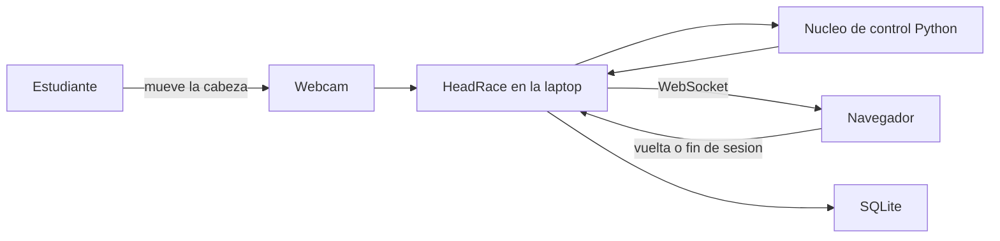

# Contexto: HeadRace

**Versión:** 1.0  
**Estado:** BORRADOR  
**Fecha:** 2026-09-25  
**Responsable:** Julio Sarmiento Peña

Este contexto es local al proyecto universitario HeadRace (CUL, Sistemas de Control). No proviene de `/sdd-init` ni de un proyecto de Azure DevOps. El estudiante pidió explícitamente una spec en esta carpeta, sin Coordinadora y sin repositorio remoto de specs.

Fuente de dominio: `HeadRace_contexto_desarrollo.md` en la raíz del proyecto.

---

## 1. Escala Proyectada

| Período | Usuarios | Transacciones/día | Observaciones |
|---|---|---|---|
| Año 1 | 1 | Decenas de sesiones de demostración | Proyecto individual de 8 semanas. Una laptop, un navegador. |
| Año 2 | 1 | Igual | No hay plan de producto. El cierre es la sustentación. |
| Año 3 | 1 | Igual | No aplica crecimiento de plataforma. |

---

## 2. Distribución Geográfica

- **Alcance:** Una laptop en Barranquilla, sin servidor remoto.
- **Justificación:** La materia exige el algoritmo de control en el ESP32 y la demo corre al lado del estudiante. No hay usuarios concurrentes ni despliegue.
- **RTO (Recovery Time Objective):** Minutos. Reiniciar el proceso local basta.
- **RPO (Recovery Point Objective):** Se acepta perder la vuelta en curso si el proceso muere. Las vueltas ya guardadas en SQLite permanecen.

---

## 3. Stack Tecnológico Confirmado

| Capa | Tecnología | Razón |
|---|---|---|
| Captura | Python + OpenCV (Haar Cascade) | Ya decidido en el contexto del curso. La webcam de la laptop alcanza. |
| Control simulado | Python, mismo algoritmo que luego irá a C++ | Permite probar sin ESP32 y portar el núcleo después. |
| Control real (fuera de esta spec) | ESP32, C++ / Arduino | Exigencia de la materia. No se implementa hasta que llegue el hardware. |
| Backend | Python, Flask + Flask-SocketIO | Ya decidido. Un solo proceso puede ser dueño del enlace. |
| Frontend | HTML + JavaScript + Canvas, sin framework | Ya decidido. Pista 2D simple. |
| Database | SQLite, archivo local | Historial de sesiones en la laptop. |
| Cache | Ninguno | Un usuario, estado en memoria del proceso. |
| Queue | Ninguno | El lazo de control es síncrono a ~20 Hz. |

---

## 4. Atributo de Calidad Crítico

**Prioridad principal:** Consistencia del lazo de control (el carro responde a la cabeza con inercia, y la velocidad sale solo de la lógica difusa).

**Por qué:** La materia evalúa PID y lógica difusa. Si el navegador calcula el movimiento, el proyecto no cumple el objetivo académico.

**Métrica objetivo:** Con la cabeza quieta en un offset constante, `car_x` queda a menos de 5 unidades del offset antes de 3 segundos, y nunca salta más de 12 unidades en un ciclo de 50 ms. La velocidad en los casos fijos de la tabla difusa coincide con el singleton de la regla (30, 60 o 90).

---

## 5. Integraciones Externas Críticas

| Sistema | Criticidad | Tipo | Fallback |
|---|---|---|---|
| Webcam de la laptop | Alta | Síncrono, local | La interfaz muestra «sin cámara». El servidor sigue vivo. La cabeza se trata como centrada. |
| ESP32 + VL53L5X | Alta en la demo final; ausente ahora | Serial USB, síncrono | Esta spec usa el núcleo de control en Python y un obstáculo simulado. |
| Navegador en localhost | Alta | WebSocket local | Si el socket cae, la pista se detiene y no se escribe una sesión a medias. |

---

## 6. Arquitectura General

### 6.1 Tipo

**Decisión:** Monolito local de un proceso Python, con el núcleo de control aislado para poder sustituirlo por el ESP32.

**Justificación:** Una persona, una laptop, un puerto serial. Separar microservicios no aporta y complica el puerto USB.

### 6.2 Topología (C4 Level 1)

Cuando llegue el hardware, el nodo «Nucleo de control Python» se reemplaza por el ESP32. El navegador, Flask y SQLite no cambian de contrato.

---

## 7. Dominios de Negocio Principales

| Dominio | Tipo | Independencia | Notas |
|---|---|---|---|
| Carrera | Integrado | Alta | Sesión, vuelta, colisión, historial. Es el módulo de esta spec. |
| Control | Integrado | Media | PID y lógica difusa. Vive en el núcleo sustituible. |
| Captura | Integrado | Media | Offset de la cabeza. Entrada del control. |

---

## 7b. Modelo Conceptual del Dominio *(vista de negocio)*

### Entidades principales del dominio

| Entidad | Qué representa en el negocio | Bounded context |
|---|---|---|
| Muestra de cabeza | Dónde está la cara respecto al centro de la imagen | Captura |
| Estado del carro | Posición lateral ya suavizada y velocidad permitida | Control |
| Obstáculo | Distancia al objeto frente al sensor, o un valor simulado | Control |
| Vuelta | Un recorrido completo de la pista con su tiempo y conteos | Carrera |
| Sesión | El tramo desde que se abre la pista hasta que el estudiante termina | Carrera |

### Relaciones entre entidades

| Origen | Relación | Destino | Cardinalidad |
|---|---|---|---|
| Sesión | contiene | Vuelta | 1:N |
| Muestra de cabeza | alimenta | Estado del carro | 1:1 por ciclo |
| Obstáculo | limita | Estado del carro | 1:1 por ciclo |
| Vuelta | resume | Estado del carro | 1:N muestras |

### Bounded contexts

| Contexto | Responsabilidad | Entidades que agrupa |
|---|---|---|
| Captura | Convertir la imagen en un offset | Muestra de cabeza |
| Control | Suavizar la posición y limitar la velocidad | Estado del carro, Obstáculo |
| Carrera | Pista, colisiones, vueltas e historial | Vuelta, Sesión |

### Reglas de negocio invariantes

- El navegador no calcula PID ni lógica difusa. Solo dibuja el estado que entrega el control y detecta colisiones con el borde.
- `car_x` sale del PID. `car_speed` sale de la lógica difusa. No se intercambian.
- Una vuelta guardada no se actualiza. Otra vuelta es otra fila.
- Si el proceso muere a mitad de una vuelta, esa vuelta no queda escrita.
- Sin lectura válida de obstáculo, no hay alerta y la distancia se trata como lejana.

### Lenguaje ubicuo (glosario)

| Término | Definición en este dominio |
|---|---|
| Offset de cabeza | Entero de −100 a 100. 0 es el centro del cuadro. Positivo es a la derecha del estudiante en la imagen. |
| Carro | Vehículo virtual. Su avance lo marca la velocidad. Su desplazamiento lateral lo marca `car_x`. |
| Vuelta | Cruce de la meta en el sentido de avance, con al menos 2 segundos desde el cruce anterior. |
| Obstáculo | Distancia en milímetros. En esta spec puede ser simulada. |
| Alerta de obstáculo | Verdadera solo si la distancia es válida y menor a 400 mm. |
| Sesión | Intervalo de uso de la pista. Termina al pulsar «Terminar sesión» o al cerrar sin guardar el tramo incompleto. |

---

## 8. Decisiones Arquitectónicas Clave

### ADR-001: Núcleo de control portable

**Decisión:** PID y lógica difusa se especifican con números cerrados en Python, detrás de una función de un ciclo, para copiarlos luego a C++.

**Alternativas rechazadas:** Calcular el control en el navegador. Usar scikit-fuzzy como motor en ejecución.

**Justificación:** La materia exige el control en el ESP32, y scikit-fuzzy no corre ahí. El detalle está en los ADR de SPEC-001.

---

### ADR-002: Un solo dueño del enlace

**Decisión:** El proceso Python es el único que hablará por Serial cuando exista el ESP32. Hoy el núcleo se invoca en el mismo proceso.

**Alternativas rechazadas:** Que la captura y Flask abran el mismo puerto. WiFi en esta etapa.

**Justificación:** Un puerto USB solo admite un dueño. El contrato JSON no cambia al sustituir el núcleo.

---

## 9. Riesgos Arquitectónicos Identificados

| # | Riesgo | Mitigación |
|---|---|---|
| 1 | Sintonía del PID distinta con la latencia real del ESP32 | Los Kp, Ki, Kd y el tope de 12 unidades por ciclo son punto de partida, no la nota final. Quedan en un solo módulo de parámetros. |
| 2 | El contrato JSON se desalinea entre Python y el futuro C++ | SPEC-001 fija los campos. Campos extra se ignoran. |
| 3 | Haar Cascade pierde la cara con poca luz | A los 500 ms sin rostro el offset vuelve a 0 y la interfaz lo indica. |

---

## 10. Plan de Evolución

**MVP (esta spec):**
- Carrera completa en simulación: cámara, PID, difusa, pista, SQLite.
- Obstáculo simulado, sin VL53L5X.

**Cuando llegue el hardware (otra spec):**
- Sustituir el núcleo Python por el ESP32 y el sensor real.
- Recalibrar umbrales de distancia y ganancias.

**Después de la sustentación:**
- No hay evolución de producto planificada.

---

## 11. Restricciones y Supuestos

### Restricciones
- Proyecto individual, sin experiencia previa en ESP32, PID, lógica difusa ni embebidos.
- El hardware aún no está. Esta spec no lo exige.
- Sin Azure DevOps, sin repo `specs` remoto, sin work items.
- Comunicación de control por un enlace de líneas JSON. WiFi queda fuera.

### Supuestos
- La webcam integrada funciona con OpenCV en la laptop del estudiante.
- El navegador es uno moderno con Canvas y WebSocket.
- Python 3.11 o superior está disponible.
- El módulo de dominio de esta spec es `carrera`.

---

## 12. Convenciones del Código *(BROWNFIELD ONLY)*

No aplica: proyecto greenfield, no hay código previo.

---

## 13. Módulos y Componentes Existentes *(BROWNFIELD ONLY)*

No aplica: proyecto greenfield, no hay código previo.

---

## 14. Deuda Técnica Conocida *(BROWNFIELD ONLY)*

No aplica: proyecto greenfield, no hay código previo.

---

## 15. Interfaces y Contratos Existentes *(BROWNFIELD ONLY)*

No aplica: proyecto greenfield, no hay contratos previos. El contrato de esta spec nace en SPEC-001.

---

## 16. Próximos Pasos

Este contexto guía las specs de HeadRace. Cada spec debe:
- Respetar el stack confirmado (sección 3)
- Alinearse con el atributo de calidad crítico (sección 4)
- Considerar los riesgos identificados (sección 9)

Siguiente artefacto: `specs/features/carrera/SPEC-001-sesion-de-carrera-simulada/`.

---

## 17. Reglas de Gobernanza SDD

**Estas reglas aplican a cualquier agente o LLM que trabaje en este proyecto.**

### Ningún código de comportamiento sin spec

No se implementa ningún cambio de comportamiento, fix o funcionalidad sin un spec aprobado que lo respalde. Esto incluye comportamiento descubierto durante la implementación o emergente en conversación.

### Si emerge un cambio no especificado, detenerse

Cuando en conversación o durante la implementación surge la necesidad de un comportamiento que no está cubierto por ningún criterio de aceptación (CA):

1. **Detener** — no escribir código que resuelva el gap
2. **Clasificar:**
   - ¿Es un detalle de implementación (nombre, estructura interna)? → continuar
   - ¿Es un comportamiento observable del sistema? → requiere CA
3. **Proponer al usuario:**
   - Si es una feature existente → `/sdd refinar [SPEC-ID]`
   - Si es funcionalidad nueva → `/sdd [descripción]`

### Trazabilidad como invariante

Todo comportamiento del sistema debe ser trazable a un CA en un spec. Si existe comportamiento sin CA, hay una brecha de trazabilidad que debe cerrarse refinando el spec — no documentándolo a posteriori en el código.

### Este SDD custom no incluye pruebas

HeadRace no usa la fase de pruebas del skill de Coordinadora. No hay `test-plan.md`, casos de prueba, tareas de test ni `/sdd-test`. Los criterios de aceptación siguen en `requirements.md` como contrato de comportamiento.

### Por qué esta regla existe

El valor de SDD se pierde si el código diverge del spec. Un fix aplicado directamente en el código sin pasar por el spec rompe la cadena de QA, deja el spec desactualizado, y hace que el siguiente desarrollador no sepa que ese comportamiento existe. La disciplina de "spec primero, siempre" es lo que mantiene el sistema auditable y mantenible.
